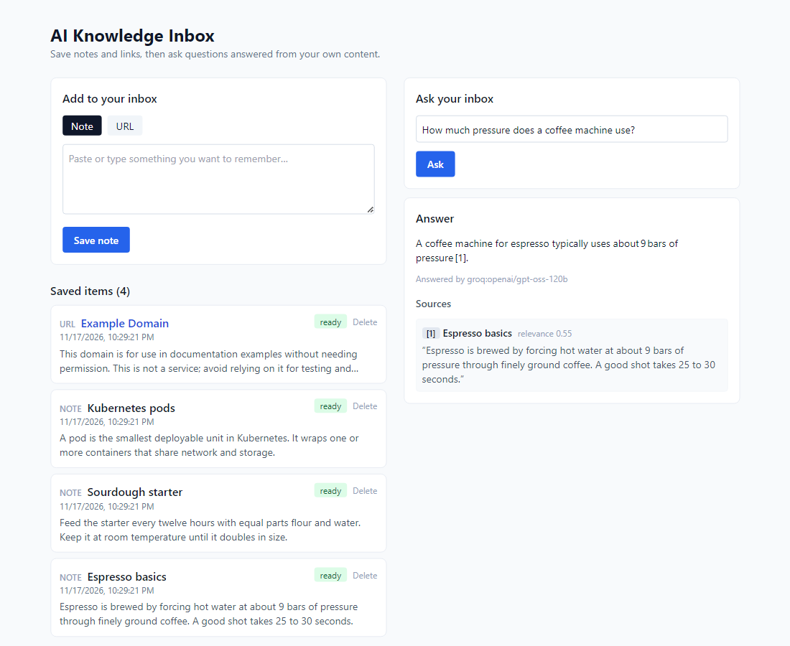
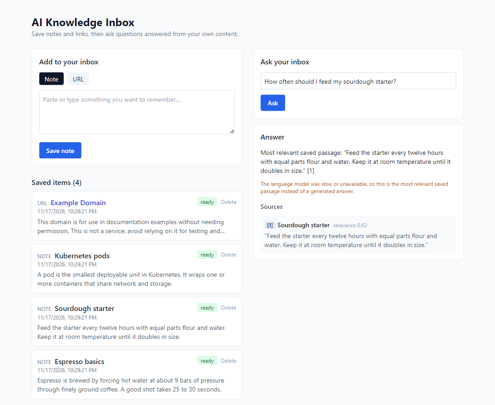
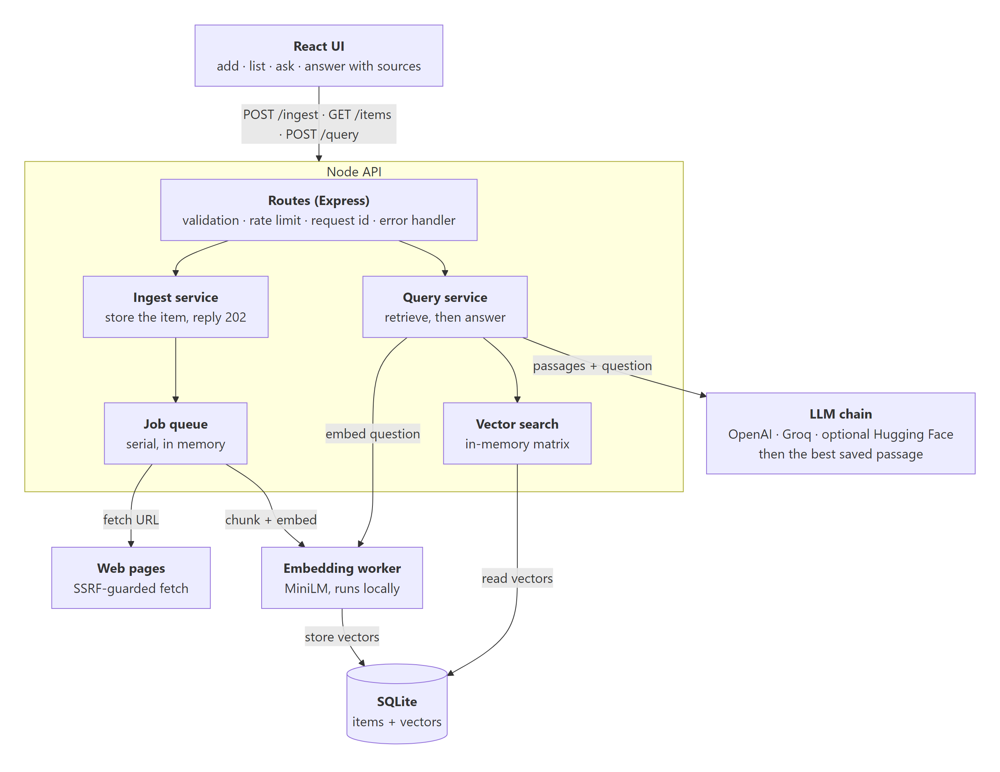
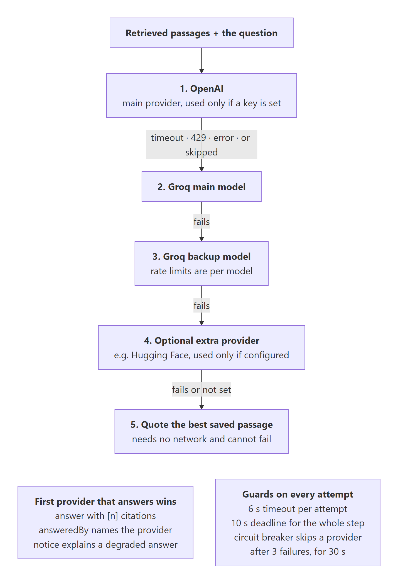

# AI Knowledge Inbox

[](https://github.com/lokesh9999b/ai-knowledge-inbox/actions/workflows/ci.yml)

Save short notes and web links, then ask questions about them. The app finds the most relevant passages in what you
saved, has a language model answer **using only those passages**, and shows you exactly which passages each answer
came from.

> **AI assistance disclosure:** This project was built with AI assistance (Claude Code). The commit history reflects
> that via `Co-Authored-By` trailers. [docs/WALKTHROUGH.md](docs/WALKTHROUGH.md) is a guided tour of the code.

**Stack:** Node 22 + Express + TypeScript · SQLite · local MiniLM embeddings (transformers.js, no API key) ·
OpenAI / Groq / any OpenAI-compatible LLM · React 18 + Vite + Tailwind · Docker + nginx.



*Left: saved notes and links, each indexed in the background (`ready`). Right: the question "How much pressure does a
coffee machine use?" is answered from the espresso note, which never uses the words "coffee machine". The answer cites
`[1]`, names the model that wrote it, and shows the exact passage with its relevance score.*

## Contents
[Try it in 5 minutes](#try-it-in-5-minutes) · [What makes it different](#what-makes-it-different) ·
[How it works](#how-it-works) · [Assignment requirements, mapped](#assignment-requirements-mapped) ·
[Design decisions and tradeoffs](#design-decisions-and-tradeoffs) · [Does it scale?](#does-it-scale-measured) ·
[Quality and testing](#quality-and-testing) · [Configuration](#configuration) · [API](#api) ·
[Project layout](#project-layout) · [Limitations](#limitations-and-what-i-would-do-next) · [Documentation](#documentation)

## Try it in 5 minutes

**With Docker (no Node, no dependency setup):**

```bash
cp .env.example .env      # optional: add OPENAI_API_KEY and/or GROQ_API_KEY for generated answers
docker compose up --build
```

Open **http://localhost:8080**. No key is required to start. The embedding model is baked into the image, the database
lives in a named volume (it survives restarts), and nginx serves the UI and proxies `/api` to the API. Stop with
`docker compose down` (add `-v` to delete the data). Change the port with `WEB_PORT=9000 docker compose up`.

**Without Docker** (Node 20+, 22 recommended):

```bash
npm install
cp .env.example .env      # optional: OPENAI_API_KEY and/or GROQ_API_KEY (Groq is free: https://console.groq.com)
npm run dev               # API on :3001, UI on http://localhost:5173
```

(The first ingest downloads the ~25 MB embedding model once. Set `EMBEDDER=hash` to skip it: offline and lexical-only.)

**What to try:**

1. Add a note: *"Espresso is brewed at about 9 bars of pressure through finely ground coffee."* It shows `processing`,
   then `ready` a moment later (indexing happens in the background).
2. Add a link, e.g. `https://example.com`. The server fetches and reads the page itself.
3. Ask *"How much pressure does a coffee machine use?"* The note never says "coffee machine" or "pressure level", yet
   it is found: retrieval is semantic, not keyword matching. The answer cites `[1]` and shows the saved passage below it.
4. Ask something unrelated. It says it found nothing relevant and does not call the model (so it cannot invent an answer).
5. Try the link `http://localhost:3001/health`. It is rejected: the server will not fetch private addresses.
6. Run with no API key at all. Questions still work: you get the best matching passage, with a notice explaining why.

## What makes it different

Most RAG demos work only when every external service is up. This one is built around **keeping working when things
fail**, and around **measuring instead of assuming**.

- **A question never fails because the LLM is slow or down.** Answers go through a fallback chain: OpenAI (if you have a
  key) → Groq's main model → Groq's backup model → an optional extra provider (e.g. Hugging Face) → the best matching
  saved passage, quoted (no network, cannot fail). Every attempt has a timeout, the whole step has one deadline
  (10 s), and a circuit breaker skips a provider that keeps failing, so a dead provider does not slow every request. The
  response says who answered (`answeredBy`) and, if degraded, why (`notice`), and the UI shows it. *Tested against the
  real APIs, including real rate limits and a real invalid-key 401.*
- **It runs with zero keys.** Embeddings run locally (MiniLM, 384-d) in a worker thread, so there is no embedding vendor,
  no per-token cost, and your notes are not sent anywhere to be indexed. LLM keys only improve the final wording.
- **Async by design.** `POST /ingest` returns `202` immediately and indexes in the background; the UI follows progress and
  failed items keep a human-readable reason (for example "The URL responded with HTTP 404").
- **Safe URL fetching.** Server-side fetching blocks private, loopback and cloud-metadata addresses, re-checks every
  redirect, and caps time, size and content type (SSRF protection, with the known remaining gap documented).
- **Grounded answers you can verify.** The model only sees numbered passages and must cite them; the same passages are
  returned as `sources`, in the same order. Nothing relevant found means no model call at all.
- **Fast without a vector database.** Vectors live in SQLite and are searched from an in-memory matrix that is
  invalidated by SQL triggers (it cannot go stale, even on cascade deletes). Measured, not guessed: see
  [Does it scale?](#does-it-scale-measured).
- **Honest engineering.** Every non-obvious choice has a short decision record ([8 ADRs](docs/adr/README.md)), there is an
  OpenAPI contract, 95 automated tests, and the docs state what was *not* verified. During development a benchmark
  script bug briefly produced wrong numbers; it was found, the numbers were corrected, and the harness now verifies what
  it is testing.

**The fallback in action.** Same data, but the language model deliberately made unavailable (an invalid API key). The
question still gets an answer, the best matching saved passage, with a plain explanation of why it is not a written
answer, instead of an error:



## How it works

<p align="center"></p>

**Saving** (`POST /ingest`): validate → store as `processing` → reply `202` → in the background: fetch the page (URLs
only) → split into ~800-character sentence-aware chunks with a little overlap → embed → store → `ready` (or `failed`
with a reason).

**Asking** (`POST /query`): embed the question → cosine similarity against every saved chunk → keep the best few above a
relevance floor → if none, say so → otherwise send those passages plus the question to the LLM chain → return the answer
and the passages it used.

**When a language model is slow or down**, the answer step falls through a chain of providers and always ends with a
result:

<p align="center"></p>

More detail, including sequence diagrams: [docs/architecture/system-design.md](docs/architecture/system-design.md). Diagram sources are in [docs/diagrams](docs/diagrams) (Mermaid); the committed images are generated by `node scripts/render-diagrams.mjs`, so they display in any viewer.

## Assignment requirements, mapped

| Requirement | How it is met | Where |
|---|---|---|
| Add text notes and URLs (fetched server-side); store raw content + metadata | Notes and fetched page text stored with timestamp, type, source URL, status | `ingestService.ts`, `urlFetcher.ts`, `db/schema.sql` |
| Chunking strategy, intentional | Sentence-aware, ~800 chars, ~120 overlap, with a rationale | `chunker.ts`, [ADR 0004](docs/adr/0004-sentence-aware-chunking.md) |
| Embeddings | Local MiniLM (384-d), no key, in a worker thread | `embedder.ts`, `workerEmbedder.ts`, [ADR 0003](docs/adr/0003-local-embeddings-groq-for-answers.md), [ADR 0006](docs/adr/0006-embedding-in-a-worker-thread.md) |
| Vector storage | SQLite + float32 blobs, in-memory cosine search | `vectorSearch.ts`, [ADR 0001](docs/adr/0001-sqlite-brute-force-vector-search.md) |
| Retrieve top chunks, pass to LLM, answer with cited sources | Numbered context, `[n]` citations mapped to returned `sources` | `queryService.ts`, `answerer.ts` |
| Frontend: add, list, ask, show answer + snippets; React hooks | `AddItemForm`, `ItemList`, `AskPanel`, `AnswerCard`; `useItems` / `useAsk` hooks | `web/src` |
| API: `POST /ingest`, `GET /items`, `POST /query` | Plus `GET/DELETE /items/:id`, `GET /health`; OpenAPI contract | [API](#api), `contract/openapi.json` |
| Request/response shape, validation, error handling, naming | zod validation, one error shape `{error:{code,message,details}}`, correct 400/404/413/422/429/500 | `routes/schemas.ts`, `middleware/errorHandler.ts` |
| Tradeoff awareness (chunking, vector store, scale, production) | Written up with measurements | [docs/DESIGN.md](docs/DESIGN.md), [system design](docs/architecture/system-design.md) |
| Debuggability: structured logs, clear errors, sensible status codes | pino JSON logs with a request id on every request, readable failure reasons | `logger.ts`, `app.ts` |
| Code quality: separation of concerns, no god files, clear naming | Thin routes → services → repositories; one composition root; small files | [Project layout](#project-layout) |
| Avoid: full auth, Kubernetes theatre, overengineering | None of those: one process, one SQLite file, Docker Compose | [ADR 0008](docs/adr/0008-docker-packaging.md) |

## Design decisions and tradeoffs

The assignment asks for four things specifically. Short answers here; the reasoning and numbers are in
[docs/DESIGN.md](docs/DESIGN.md).

| Question | Answer |
|---|---|
| **Chunking rationale** | Split on sentences, pack to ~800 characters, carry ~120 characters of overlap. Keeps each chunk about one idea, keeps citations readable, fits the embedding model's input, and saves facts that straddle a boundary. |
| **Vector store choice** | SQLite plus an in-memory matrix: zero infrastructure, exact results, transactional with the metadata. Right for one user and thousands of chunks. |
| **What breaks at scale** | The scan is O(n): about 4 ms per query at 10k chunks, 24 ms at 50k, 51 ms at 100k (measured), and it runs on the main thread. One process, one SQLite writer, an in-memory job queue, no auth or tenancy. |
| **What changes in production** | pgvector or Qdrant for search, a durable queue with separate indexing workers, Postgres, auth and per-user isolation, caching and quotas, hybrid search with reranking, and metrics on which LLM provider answered. |

Each decision is recorded in an [ADR](docs/adr/README.md): vector store, async ingest, local embeddings, chunking, URL
safety, embedding worker, the LLM fallback chain, Docker packaging.

## Does it scale? (measured)

One instance, on a laptop, real embedding model, 1000+ requests per run, zero failed requests. Full method and tables:
[system design, section 5](docs/architecture/system-design.md#5-capacity-can-it-handle-1000-requests).

| Scenario | Result |
|---|---|
| Save 1000 notes at once | all accepted in 1.3 s; indexed in the background at about 100 notes/s |
| List items (1400 items, 50 per page) | about 1000 requests/s, p50 85 ms |
| Ask questions (1400 chunks, retrieval only) | about 240 requests/s, p50 201 ms |
| API health check while queries are running | p95 34 ms (was 631 ms before embedding moved to a worker thread) |
| Real generated answers | about 600 ms for one caller; the LLM provider's rate limit, not this server, is the ceiling |

Two bottlenecks found by load testing were fixed (an unpaginated list endpoint and a per-query vector read), and
the measured wall for the next one (the O(n) scan, around 10k+ chunks) is documented with its fix.

## Quality and testing

- **95 automated tests** (85 server, 10 web): chunker, SSRF guard, validation and error shapes, pagination, the vector
  cache and its invalidation, the embedding worker, the LLM chain and circuit breaker (against a fake provider over real
  HTTP that can answer, rate limit or hang), config validation, and the React components and hooks.
- **CI on every change** (GitHub Actions): lint, typecheck, tests, build, **and** a job that builds the Docker images,
  starts the stack, saves a note, waits for indexing, asks a question through nginx, and checks data survives a restart.
- Verified by hand against the real Groq and OpenAI APIs (healthy, rate limited, bad key, timeouts) and in a browser.
- `npm test`, `npm run lint`, `npm run typecheck`, `npm run build` all run from the repo root.

## Configuration

Everything is optional. See [.env.example](.env.example). The main settings:

| Variable | Default | Meaning |
|---|---|---|
| `OPENAI_API_KEY`, `OPENAI_MODEL` | unset, `gpt-4o-mini` | Main LLM when a key is set (`OPENAI_BASE_URL` for Azure or a gateway) |
| `GROQ_API_KEY`, `GROQ_MODEL` | unset, `openai/gpt-oss-120b` | Groq LLM; `GROQ_FALLBACK_MODEL` is the backup model |
| `FALLBACK_LLM_BASE_URL` / `_API_KEY` / `_MODEL` | unset | Optional extra provider, e.g. Hugging Face's router (set all three) |
| `LLM_TIMEOUT_MS`, `LLM_DEADLINE_MS` | 6000, 10000 | Per-attempt timeout and the cap on the whole LLM step |
| `EMBEDDER`, `EMBED_WORKERS` | `local`, 1 | Local model or the offline hash embedder; worker threads (0 = main thread) |
| `RATE_LIMIT_PER_MINUTE` | 60 | Per-IP limit on `/ingest` and `/query` (0 disables, for load tests) |
| `DB_PATH`, `PORT`, `LOG_LEVEL` | `./data/inbox.db`, 3001, `info` | Storage, port, logging |

With no LLM key at all the app still answers (quoting the best passage). Hugging Face is otherwise used only to download
the local embedding model.

## API

| Method & path | Purpose | Success |
|---|---|---|
| `POST /ingest` | `{type:"note",content,title?}` or `{type:"url",url,title?}` | `202 {item}` (indexed in the background) |
| `GET /items` | Newest first, paginated: `?limit=50&cursor=...&status=processing` (or `ready`, `failed`) | `200 {items, nextCursor, total}` |
| `GET /items/:id` | One item including its full raw content | `200 {item}` |
| `DELETE /items/:id` | Remove an item and its vectors | `204` |
| `POST /query` | `{question, topK?=5}` | `200 {answer, sources[], usedFallback, answeredBy, notice?}` |
| `GET /health` | Liveness | `200` |

Errors always look like `{ "error": { "code": "VALIDATION_ERROR", "message": "...", "details": [...] } }`, with
400 / 404 / 413 / 422 / 429 / 500. Every response carries an `x-request-id` that also appears in the logs.

```bash
curl -X POST localhost:3001/ingest -H 'content-type: application/json' \
  -d '{"type":"note","content":"Espresso is brewed at about 9 bars of pressure."}'

curl -X POST localhost:3001/query -H 'content-type: application/json' \
  -d '{"question":"What pressure does espresso need?"}'
```

`sources[]` entries are `{ itemId, chunkId, title, sourceUrl, snippet, score }`, in the same order as the `[n]`
citations in the answer. Full contract: [contract/openapi.json](contract/openapi.json).

## Project layout

```
server/src
  config.ts  logger.ts  errors.ts  container.ts (composition root)  app.ts  index.ts
  db/          SQLite connection, schema.sql (with triggers), items and chunks repositories
  services/    chunker · embedder, embedWorker, workerEmbedder · urlSafety, urlFetcher · vectorSearch
               answerer, answererChain, answererFactory (LLM chain) · jobQueue · ingestService, queryService
  routes/      ingest, items, query, cursor, zod schemas
  middleware/  validation, error handler
server/test    unit and integration tests (fake embedder, LLM and fetcher; a fake OpenAI-compatible server)
web/src
  api/         typed fetch client            hooks/       useItems (pagination, polling), useAsk
  components/  AddItemForm, ItemList, AskPanel, AnswerCard, ErrorBanner
docs/          architecture/system-design.md, adr/, DESIGN.md, WALKTHROUGH.md, diagrams/ (Mermaid sources), images/
contract/      openapi.json
Dockerfile, docker-compose.yml, web/nginx.conf, scripts/ (load-test.mjs, render-diagrams.mjs)
```

Routes are thin, business logic lives in services, and `container.ts` is the only place real implementations are wired
together, so tests swap in fakes without mocking modules.

## Limitations, and what I would do next

Stated plainly, because they matter more than the features:

- **One instance.** SQLite and an in-memory job queue mean a single API process; queued indexing jobs are lost on a
  restart (those items show as `failed`). Scaling out needs Postgres + pgvector and a durable queue.
- **The vector scan is O(n).** Fine to roughly 10k chunks (4 ms), a bottleneck beyond; the fix is an ANN index.
- **No authentication or multi-user separation** (not required here; the first thing to add for real use).
- **URL fetching has one known gap:** a DNS-rebinding race between the address check and the connection.
- **Verified vs not verified.** Groq and the fallback chain were exercised against the real API. OpenAI was verified only
  for the failure path (a real 401 falling back to Groq), because no OpenAI key was available. The Hugging Face tier
  authenticates but its account has no inference credits, so no generated answer was produced through it. The Docker
  images are built and smoke-tested in CI; Docker Desktop would not start on the author's own machine.
- **A degraded answer is a quoted passage**, not a written answer, so clients should read `notice`.

## Documentation

- [docs/DESIGN.md](docs/DESIGN.md): tradeoffs (chunking, vector store, scale, production)
- [docs/architecture/system-design.md](docs/architecture/system-design.md): diagrams, data model, measured capacity, scaling path
- [docs/adr/](docs/adr/README.md): decision records
- [docs/WALKTHROUGH.md](docs/WALKTHROUGH.md): guided tour of the code and likely questions
- [contract/openapi.json](contract/openapi.json): the API contract
