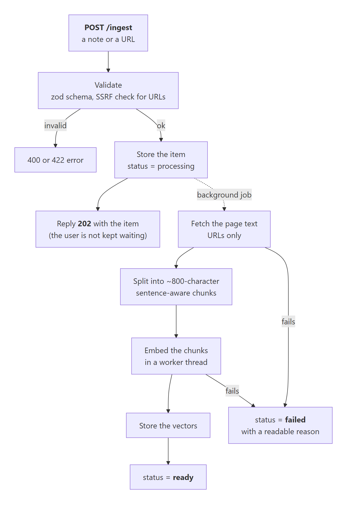
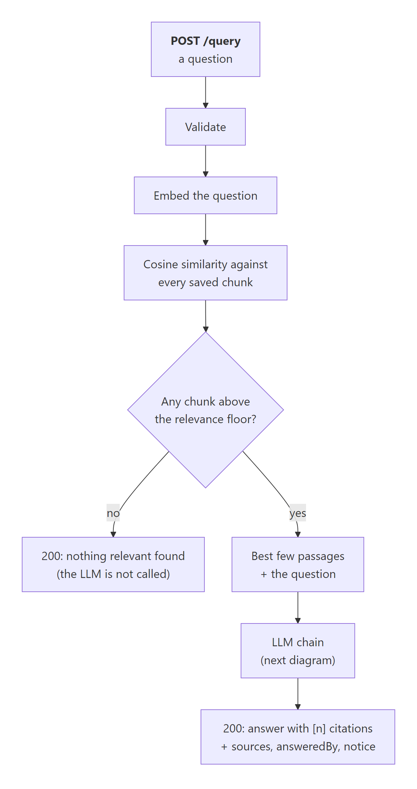
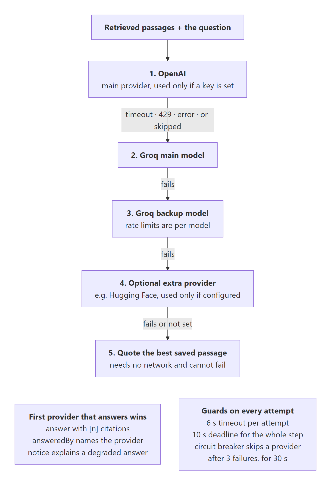

# Design notes and tradeoffs

The four tradeoff questions from the assignment, answered against the system as it is today. Measurements and
diagrams are in [architecture/system-design.md](architecture/system-design.md); each decision has a record in
[adr/](adr/README.md).

## The pipeline in one view

**Saving a note or link** (indexing happens in the background):

<picture><source media="(prefers-color-scheme: dark)" srcset="images/diagrams/saving-flow-dark.png"></picture>

**Asking a question:**

<picture><source media="(prefers-color-scheme: dark)" srcset="images/diagrams/asking-flow-dark.png"></picture>

The LLM step in detail:

<picture><source media="(prefers-color-scheme: dark)" srcset="images/diagrams/llm-chain-dark.png"></picture>

## 1. Chunking approach and rationale

Sentence-aware sliding window: split on paragraph and sentence boundaries, pack greedily to about **800 characters**
(roughly 200 tokens), and carry about **120 characters** of overlap (whole trailing sentences) into the next chunk.
([ADR 0004](adr/0004-sentence-aware-chunking.md))

- **Why not fixed-size character windows?** They cut sentences in half, which hurts embedding quality and makes citation
  snippets unreadable.
- **Why about 800 characters?** Small enough that a chunk is about one idea (sharper retrieval, cheaper prompts), large
  enough to keep context, and well inside the embedding model's 256-token input limit so nothing is silently truncated.
- **Why overlap?** A fact that straddles a boundary stays retrievable from either side.
- **Edge cases:** one over-long "sentence" (minified text, code, tables) falls back to word-level, then character-level,
  splitting, and the loop is guaranteed to make progress.
- **Not done on purpose:** heading-aware or parent-child chunking. Worth it once documents are long and structured.

## 2. Vector store choice

**SQLite, with embeddings stored as float32 blobs and searched from an in-memory matrix.**
([ADR 0001](adr/0001-sqlite-brute-force-vector-search.md))

- Zero infrastructure, one file, transactional with the item metadata (deleting an item cascades to its vectors), and
  exact results with no recall tuning. It matches the "run locally with one command" goal and a single-user inbox.
- **Fast without an index:** all vectors are packed into one `Float32Array`, rebuilt only when a database *revision*
  changes. The revision is bumped by SQL triggers on any chunk insert or delete or item status change, **including
  cascade deletes**, so the cache cannot go stale whichever code path wrote.
- Each chunk stores which embedding model produced it, and search only compares vectors from the same model.

**Embeddings:** local all-MiniLM-L6-v2 (384-d) through transformers.js, running in a worker thread
([ADR 0003](adr/0003-local-embeddings-groq-for-answers.md), [ADR 0006](adr/0006-embedding-in-a-worker-thread.md)). Local
means no embedding vendor or key, no per-token cost, and notes are not sent anywhere to be indexed. A small deterministic
hashing embedder exists for tests and offline use (lexical only).

**Answers** come from an LLM chain, so a slow or failing provider never breaks a question
([ADR 0007](adr/0007-llm-fallback-chain-and-circuit-breaker.md)): OpenAI (if configured) → Groq main model → Groq backup
model → an optional extra provider → the best matching passage, quoted. The prompt restricts the model to numbered passages
and asks for `[n]` citations; the same passages are returned as `sources`. If nothing relevant is retrieved, the LLM is not
called at all, which avoids both invented answers and wasted calls.

## 3. What breaks at scale

Measured on one instance (details in the system design doc):

| Area | Where it stands | What breaks first | Fix |
|---|---|---|---|
| Vector search | In-memory matrix, exact scan: 4 ms at 10k chunks, 24 ms at 50k, 51 ms at 100k (146 MB) | Past roughly 10k to 50k chunks the O(n) scan, which runs on the main thread, dominates and stalls other requests | An ANN index (pgvector HNSW or Qdrant) |
| Ingest | Async: 1000 notes accepted in 1.3 s, indexed at about 100/s | The in-process queue loses jobs on restart (items show as `failed`); no retries | Durable queue (BullMQ, SQS) with separate indexing workers |
| Embedding | Worker thread: API stays responsive under load (health p95 34 ms) | One worker saturates the CPU; two were slower, not faster | A separate embedding service, scaled independently |
| Listing | Keyset-paginated: about 1000 req/s at 1400 items | Polling cost if many items are processing at once | SSE or webhooks instead of polling |
| LLM answers | Fallback chain, timeouts, breaker | The provider's own rate limit is the ceiling (a burst of 50 got 33 rate limited) | Higher tier, answer cache, cap on concurrent LLM calls |
| Storage and tenancy | One SQLite file, no `user_id` | Single writer, single node, single user | Postgres, per-user filtering, auth |
| URL fetching | SSRF guard, size and time caps | DNS-rebinding race; no JavaScript rendering or PDFs | Pin the resolved IP or use an egress proxy; a headless render service |
| Retrieval quality | Dense retrieval, fixed top-k | Keyword-heavy questions, near-duplicate chunks | Hybrid BM25 + vector, a reranker, MMR for diversity |

## 4. What I would change for production

1. Postgres with pgvector (migrations, connection pooling) in place of SQLite, and an ANN index.
2. A durable job queue with retries and backoff, idempotent indexing, and a re-index path when the embedding model changes.
3. Authentication (OIDC), per-user isolation on every query, quotas and per-user rate limits.
4. Observability: request ids and structured logs already exist; add metrics (queue depth, retrieval and LLM latency,
   `answeredBy` mix) and alerts, because an LLM outage no longer shows up as HTTP errors.
5. A small labelled question set to track retrieval recall and answer faithfulness when changing chunking or models.
6. Streaming answers, a stricter prompt-injection policy for fetched pages, and PDF and Markdown support.
7. Push images from CI to a registry; secrets from a secrets manager; TLS at a reverse proxy.

## API conventions

- `POST /ingest` returns `202 { item }`: accepted, not finished. Poll `GET /items?status=processing`.
- `GET /items` is keyset-paginated (`limit`, `cursor`, `status`) and returns `{ items, nextCursor, total }`.
- `POST /query` returns `200 { answer, sources, usedFallback, answeredBy, notice? }`.
- Errors are always `{ error: { code, message, details? } }`: `400` validation, `404`, `413`, `422` (well-formed but
  unprocessable, such as a private URL), `429`, `500`.
- Every response has an `x-request-id`, which also appears in the structured logs.

## Security notes

- SSRF guard on URL ingest: resolve and reject private, loopback, link-local and metadata ranges (IPv4 and IPv6), re-check
  every redirect hop, 10 s timeout, 2 MB cap, content-type allowlist ([ADR 0005](adr/0005-ssrf-guarded-url-fetch.md)).
- Fetched page text is untrusted model input (prompt injection). The prompt constrains the model to the numbered
  passages, which is a mitigation and not a guarantee.
- Secrets only through the environment (`.env` is git-ignored); request size limits; a per-IP rate limit on the
  expensive endpoints.
