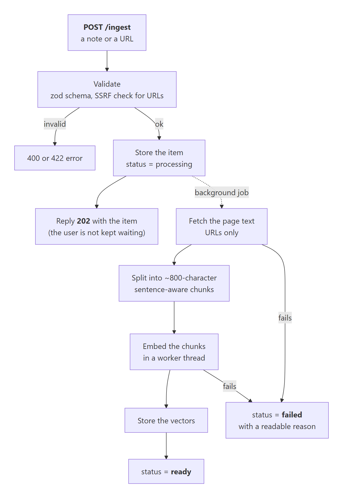
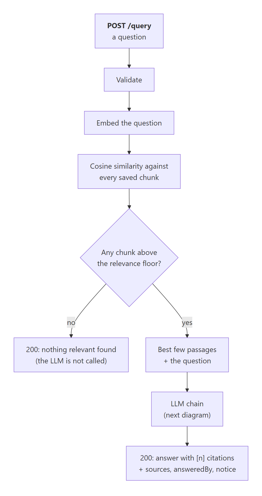

# Code walkthrough

A guided tour of how the app works and why each piece is the way it is. Read it next to the code.

## 1. The big picture

Two moving parts: **indexing** (slow, async) and **asking** (fast, sync).

**Saving a note or link** (indexing happens in the background):

<picture><source media="(prefers-color-scheme: dark)" srcset="images/diagrams/saving-flow-dark.png"></picture>

**Asking a question:**

<picture><source media="(prefers-color-scheme: dark)" srcset="images/diagrams/asking-flow-dark.png"></picture>

Why async ingest? Fetching a page and embedding chunks can take seconds. Returning `202` immediately keeps the
API responsive; the UI polls `GET /items?status=processing` (a small listing) and re-fetches only items that finished.
`GET /items` itself is keyset-paginated (`limit`, `cursor`, `nextCursor`, `total`) and the UI has "Load more".

## 2. Follow one request through the server

**`POST /ingest` with a URL**
1. `routes/ingest.ts`: `validateBody(ingestSchema)` (`routes/schemas.ts`, zod) rejects bad input with a 400 before any logic runs.
2. `services/ingestService.ts` → `ingest()`: parses the URL and runs the SSRF check (`urlSafety.ts`) so private addresses are rejected up front with a 422. It then inserts the item as `processing` and enqueues a job.
3. `services/jobQueue.ts`: runs jobs one at a time (a promise chain). Embedding is CPU-heavy; serial keeps memory predictable.
4. The job calls `urlFetcher.ts`: manual redirects (each hop re-checked), 10s timeout, 2MB cap, content-type check, then cheerio strips scripts/nav/footers and returns title + text.
5. `chunker.ts` splits the text; `embedder.ts` turns chunks into vectors (the model runs in a worker thread via `workerEmbedder.ts`, so inference never blocks the API); `db/chunksRepo.ts` stores them in one transaction; status becomes `ready`. Any error marks the item `failed` with a readable reason.

**`POST /query`**
1. `queryService.ts` → `vectorSearch.ts`: embed the question, dot-product against every stored chunk, held in memory as one matrix that is rebuilt only when a DB revision counter (bumped by SQL triggers) changes (vectors are normalised, so dot = cosine), drop anything below the model's `minScore`, take top-k.
2. No survivors → return "couldn't find anything" **without calling the LLM** (cheaper, and no invented answers).
3. Otherwise the answer comes from the LLM chain (`answererFactory.ts` builds it from config, `answererChain.ts` runs it): OpenAI if a key is set, then Groq's main model, then its backup model, then an optional extra provider. Each is a `ChatAnswerer` in `answerer.ts`, which builds a numbered context (`[1] title…`) and asks the model to answer only from it and cite `[n]`. The same ordered chunks are returned as `sources`, so the UI can show what each `[n]` refers to.
4. Each attempt has a timeout, the whole chain has one deadline, and a circuit breaker skips a provider that keeps failing. If every provider fails (or none is configured), `ExtractiveAnswerer` quotes the best passage. The response carries `answeredBy` and a `notice` when degraded, so a question never errors just because the LLM is slow or down.

## 3. Design decisions and the reasoning behind them

| Decision | Why | Tradeoff |
|---|---|---|
| Sentence-aware chunks, ~800 chars, ~120 overlap | Chunks stay coherent; citations read well; fits MiniLM's input limit; overlap saves boundary facts | More chunks than big windows; fixed sizes ignore document structure |
| SQLite + float32 BLOBs, searched from an in-memory matrix | One file, no infra, transactional with metadata; exact results; matrix rebuilt only when a DB revision (bumped by triggers) changes | O(n) per query: 4 ms at 10k chunks, 51 ms at 100k; needs an index beyond that |
| Local MiniLM embeddings in a worker thread | No embedding vendor or key; content stays local; inference never blocks the API | ~25MB model (baked into the Docker image); one worker was fastest, two were slower |
| LLM fallback chain + circuit breaker | A slow or failing provider never breaks a question; every wait is bounded | A degraded answer is a quoted passage; outages show in logs and `answeredBy`, not HTTP errors |
| `GET /items` keyset pagination | Constant-cost pages, no OFFSET rescans | Clients follow an opaque cursor |
| `embedder` id stored per chunk | Vectors from different models are never compared | Changing model means re-adding items |
| `minScore` threshold, skip LLM if empty | Avoids hallucination and wasted calls | Threshold is a heuristic and needs tuning with real data |
| In-process serial job queue | Simple; no Redis | Jobs lost on restart (startup marks leftovers `failed`) |
| `container.ts` composition root | One place wires real classes; tests inject fakes (no module mocking) | A little indirection |
| Error shape `{error:{code,message}}` + `AppError` | One handler (`middleware/errorHandler.ts`) maps everything to consistent status codes | None worth noting |

## 4. File map

- `server/src/config.ts` env parsing (zod). `logger.ts` pino. `errors.ts` `AppError` + status mapping.
- `server/src/db/` schema, connection, `itemsRepo`, `chunksRepo`.
- `server/src/services/` all business logic (see section 2): `chunker`, `embedder` + `embedWorker` + `workerEmbedder`, `urlSafety` + `urlFetcher`, `vectorSearch`, `answerer` + `answererChain` + `answererFactory`, `jobQueue`, `ingestService`, `queryService`.
- `server/src/routes/` + `middleware/` thin HTTP layer.
- `server/src/app.ts` builds Express (logging w/ request id, CORS, rate limit, routes). `index.ts` starts it.
- `server/test/` unit and integration tests (hash embedder, stub or fake LLM and fetcher, a fake OpenAI-compatible server that can answer, rate limit or hang).
- `web/src/api/client.ts` typed fetch + `ApiError`. `hooks/useItems.ts` (polls while processing), `hooks/useAsk.ts`.
- `web/src/components/` `AddItemForm`, `ItemList`, `AskPanel`, `AnswerCard`, `ErrorBanner`.

## 5. Things to be ready to explain

1. **Why does `/ingest` return 202?** Work continues after the response; the item is accepted, not finished.
2. **How does the SSRF guard work, and what does it miss?** Resolves the host and rejects private/loopback/link-local ranges, re-checking each redirect hop. It misses DNS rebinding (resolve-then-connect race); fix by pinning the resolved IP or using an egress proxy.
3. **Why cosine as a dot product?** Embeddings are L2-normalised on creation.
4. **What breaks at scale?** The O(n) vector scan past roughly 10k chunks (measured: 4 ms at 10k, 51 ms at 100k), the in-memory job queue, a single SQLite writer, no auth or tenancy, and the LLM provider's own rate limit. Pagination, the vector cache and the embedding worker are already done. See `docs/DESIGN.md` for the rest (pgvector/Qdrant, durable queue + workers, Postgres, per-user isolation).
5. **How would you improve retrieval quality?** Hybrid BM25 + vector, a reranker, MMR for diversity, and a small labelled eval set to measure recall@k.
6. **How do you reduce hallucination?** Prompt restricts to numbered context, low temperature, no-results short-circuit, citations mapped to real chunks.
7. **Prompt injection from fetched pages?** Page text is passed as context, not instructions, but a hostile page could still try to steer the model. Mitigations: stricter prompt, output filtering, treating fetched content as untrusted.
8. **Why polling instead of websockets/SSE?** Simplest thing that works for a single user; SSE would be the next step.
9. **How would you add auth?** `user_id` column on items/chunks, filter every query by it, session/OIDC middleware in front of the routers.
10. **A bug found while building:** the default Groq model had been retired, so the app returned a clear 502. That led to the env-configurable model and then the fallback chain, so a retired model, a rate limit or an outage now degrades to a backup or a quoted passage instead of an error.
11. **What happens when the LLM is down?** The chain falls through its providers within a 10 s deadline, then quotes the best passage with a `notice`. A circuit breaker stops paying the timeout on every request.
12. **Why is the embedding model in a worker thread, and why only one?** Inference is CPU-bound and blocked the event loop (health checks took 631 ms at p95 under load; 34 ms with the worker). The model already uses every core, so two workers measured slower than one.
13. **How do you know the vector cache is never stale?** SQL triggers bump a revision counter on any chunk insert or delete or item status change, including cascade deletes, and the cache is rebuilt when the revision changes. A test covers add, delete and cascade.

## 6. Try it yourself (best way to learn it)

- Add a note, then run `sqlite3 server/data/inbox.db "select position, text from chunks"` and look at the chunks.
- Lower `maxChars` in `chunker.ts`, re-add the same text, and watch retrieval change.
- Set `EMBEDDER=hash` and compare how it handles synonyms ("pressure" vs "bars") against `local`.
- Break something on purpose (bad URL, `localhost` URL, 20k+ char note) and read the structured logs.
- Stretch tasks: a `POST /items/:id/reindex` endpoint, or hybrid keyword + vector scoring.
