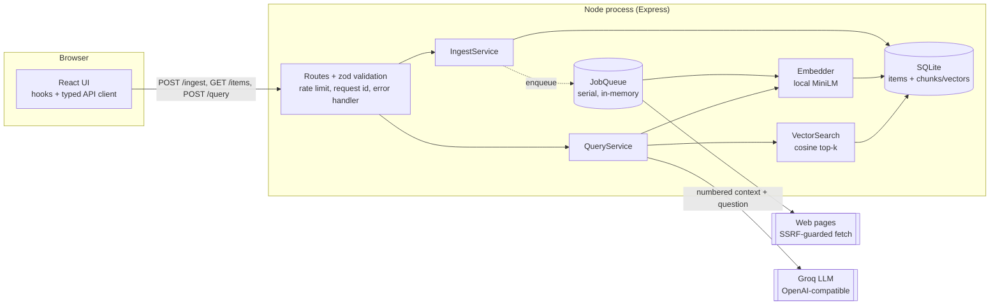
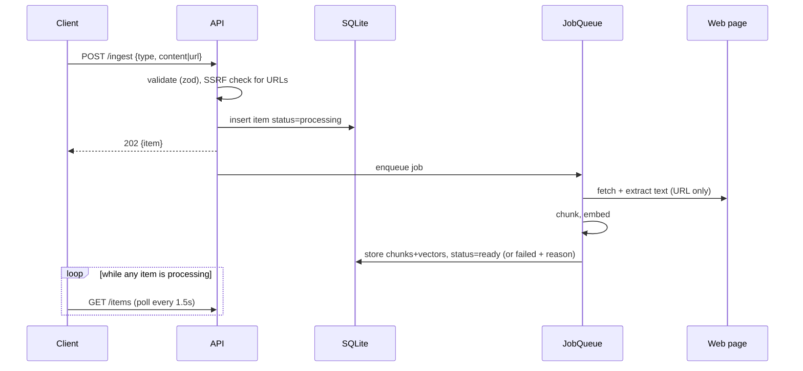
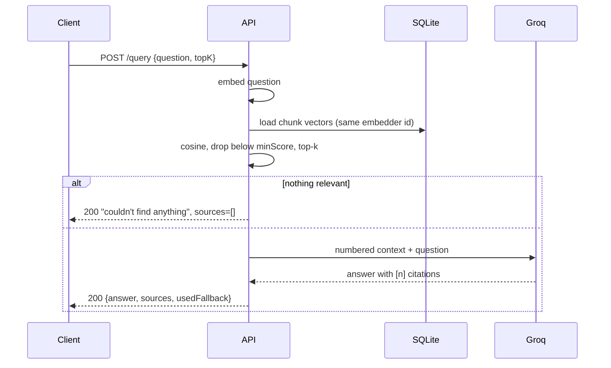

# System design

How the AI Knowledge Inbox is put together, how far it scales today (measured), and how it would grow.
Decisions are recorded as short ADRs in [`../adr`](../adr/README.md); the API contract is
[`../../contract/openapi.json`](../../contract/openapi.json).

## 1. Requirements that shaped the design

| Requirement | Consequence |
|---|---|
| Save notes and URLs; single user, no auth | One inbox, no tenancy. Rows have no `user_id` yet (see section 6). |
| Fetching and embedding are slow, asking must be fast | Async ingest: accept immediately, process in the background ([ADR 0002](../adr/0002-async-ingest-with-in-process-queue.md)). |
| Answers must be grounded and cited | Retrieve first, restrict the LLM to numbered passages, return the same passages as `sources`. |
| Runs locally with one command | SQLite file, in-process queue, local embeddings: no Docker, no Redis, no vector DB ([ADR 0001](../adr/0001-sqlite-brute-force-vector-search.md)). |
| Debuggable | Structured logs with a request id, consistent error codes, failed items store a reason. |

## 2. Component view



Layering rule (same idea as the SCMS backend): routes are thin and only validate and translate; services own the
rules; repositories own SQL; `container.ts` is the only place concrete classes are wired, so tests substitute
fakes for the embedder, LLM and fetcher.

## 3. Request flows

### Ingest (async)



### Query (sync)



## 4. Data model

```
items(id, type note|url, title, source_url, content, status processing|ready|failed, error, created_at)
chunks(id, item_id → items ON DELETE CASCADE, position, text, embedder, embedding BLOB float32[384])
```

`embedder` is stored per chunk so vectors from different models are never compared.

## 5. Capacity: can it handle 1000+ requests?

**Yes, 1000+ requests complete with zero errors. Sustained throughput has a ceiling, and it drops as data grows.**

Measured with `scripts/load-test.mjs` against a single Node process on a Windows dev laptop (loopback, so treat as
relative numbers). Setup: real local MiniLM embeddings, no Groq (extractive answers, so LLM latency is *not* included),
`RATE_LIMIT_PER_MINUTE=0`.

| Scenario | Requests / concurrency | Throughput | p50 | p99 | Errors |
|---|---|---|---|---|---|
| `GET /items`, 400 items | 2000 / 100 | 420 rps | 227 ms | 309 ms | 0 |
| `GET /items`, 1400 items (581 KB response) | 500 / 100 | 120 rps | 776 ms | 921 ms | 0 |
| `POST /query`, 400 chunks | 1000 / 50 | 134 rps | 361 ms | 439 ms | 0 |
| `POST /query`, 400 chunks | 1000 / 200 | 116 rps | 1.7 s | 3.0 s | 0 |
| `POST /query`, 1400 chunks | 500 / 50 | 77 rps | 618 ms | 788 ms | 0 |
| `POST /ingest` burst | 1000 / 50 | 837 rps (all `202`) | 45 ms | 130 ms | 0 |
| Indexing the 1000-note backlog | n/a | ~100 notes/s, drained in ~10 s | n/a | n/a | 0 failed |
| `POST /query` while that backlog drains | 100 / 10 | 112 rps | 76 ms | 148 ms | 0 |

What the numbers say:

- **Ingest scales best because it is async.** The API accepted 1000 notes in 1.2 s; the work drained in the background.
  Reads stayed responsive during the backlog.
- **Query is the bottleneck (about 77 to 134 rps per instance).** Each query embeds the question on the main thread and
  reads and decodes every stored vector from SQLite, so cost grows with data: throughput fell from 134 to 77 rps when
  chunks went from 400 to 1400.
- **`GET /items` is unpaginated**, so it returns the whole inbox every time (581 KB at 1400 items) and the UI polls it.
  This is the first thing to fix.
- **Real `/query` is slower than measured**: it adds a Groq call (hundreds of ms) and is bound by Groq's own rate
  limits, which were not measured here.
- **Default rate limit is 60 requests/min per IP** on `/ingest` and `/query`, so one client cannot actually send 1000
  requests a minute. That is deliberate protection of the LLM quota; the load tests disable it.

## 6. Scaling path

Do these in order; each removes the current top bottleneck.

| Step | Change | Removes |
|---|---|---|
| 1 | Paginate `GET /items` (`limit`, `cursor`) and poll only `processing` items | 581 KB responses and poll cost |
| 2 | Cache decoded vectors in memory (one `Float32Array` matrix), invalidate on index/delete | Per-query SQLite read and decode |
| 3 | Run embedding in a worker thread (or a separate service) | Event-loop blocking during embed |
| 4 | Run several API instances behind a load balancer; move queue to a durable broker (BullMQ/SQS) with separate indexing workers | Single process ceiling, lost jobs on restart |
| 5 | Postgres + pgvector (HNSW) or Qdrant; per-user `user_id` filters; auth | O(n) scan, single writer, single tenant |
| 6 | Response cache for repeated questions, per-user quotas, hybrid BM25 + vector with reranking | LLM cost and retrieval quality |

Failure handling today: a failed fetch/embed marks the item `failed` with a message; a restart marks leftover
`processing` items `failed` (the queue is in memory); an LLM failure returns `502` with a readable message and never
a partial answer.

## 7. Security notes

- SSRF guard on URL ingest: resolve and reject private/loopback/link-local ranges, re-check every redirect hop,
  10 s timeout, 2 MB cap, content-type allowlist. Known gap: DNS-rebinding race between check and connect.
- Fetched page text is untrusted model input (prompt injection); the prompt constrains the model to the numbered
  passages, but this is mitigation, not a guarantee.
- Secrets only via environment (`.env` is git-ignored); input size limits on every body; per-IP rate limit.
