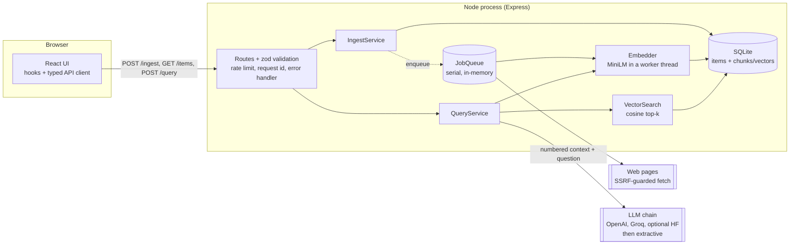
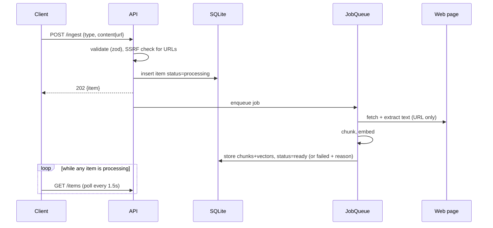
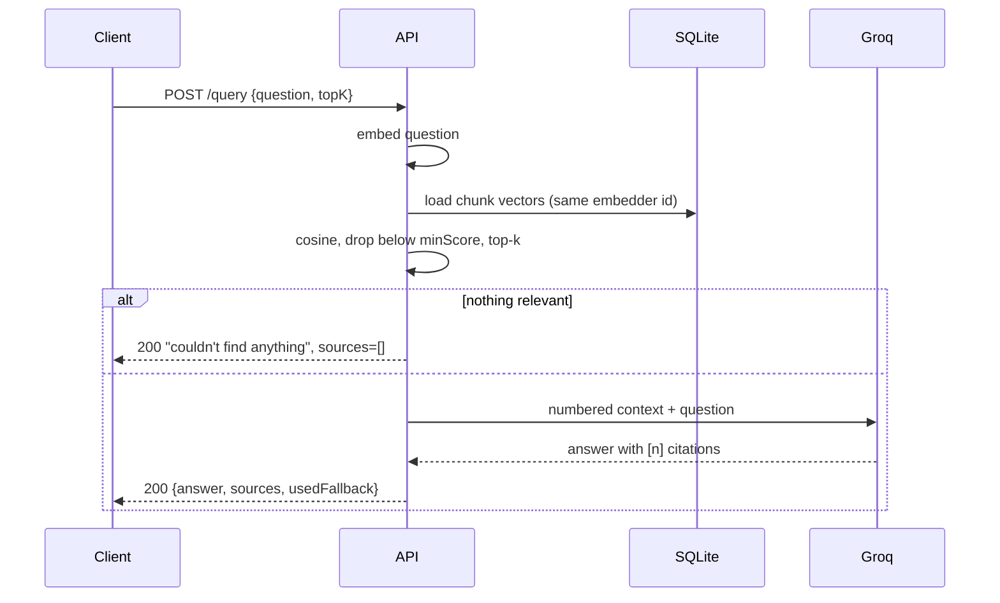

# System design

How the AI Knowledge Inbox is put together, how far it scales today (measured), and how it would grow.
Decisions are recorded as short ADRs in [`../adr`](../adr/README.md); the API contract is
[`../../contract/openapi.json`](../../contract/openapi.json).

## 1. Requirements that shaped the design

| Requirement | Consequence |
|---|---|
| Save notes and URLs; single user, no auth | One inbox, no tenancy. Rows have no `user_id` yet (see section 6). |
| Fetching and embedding are slow, asking must be fast | Async ingest: accept immediately, process in the background ([ADR 0002](../adr/0002-async-ingest-with-in-process-queue.md)). |
| Answers must be grounded and cited | Retrieve first, restrict the LLM to numbered passages, return the same passages as `sources`. |
| Runs locally with one command | SQLite file, in-process queue, local embeddings: no Docker, no Redis, no vector DB ([ADR 0001](../adr/0001-sqlite-brute-force-vector-search.md)). |
| Debuggable | Structured logs with a request id, consistent error codes, failed items store a reason. |

## 2. Component view



Layering rule (same idea as the SCMS backend): routes are thin and only validate and translate; services own the
rules; repositories own SQL; `container.ts` is the only place concrete classes are wired, so tests substitute
fakes for the embedder, LLM and fetcher.

## 3. Request flows

### Ingest (async)



### Query (sync)



## 4. Data model

```
items(id, type note|url, title, source_url, content, status processing|ready|failed, error, created_at)
chunks(id, item_id → items ON DELETE CASCADE, position, text, embedder, embedding BLOB float32[384])
```

`embedder` is stored per chunk so vectors from different models are never compared.

## 5. Capacity: can it handle 1000+ requests?

**Yes. Every run below sent 1000 to 2000 requests with zero dropped or failed requests (apart from the provider rate
limit described under "Real answers"). One instance sustains about 240 queries/s and about 1000 list requests/s at
1400 items, and stays responsive while it does.**

Method: `scripts/load-test.mjs` against a single Node process on a Windows dev laptop (loopback, so treat as relative
numbers). Real local MiniLM embeddings, extractive answers (no Groq) unless stated, `RATE_LIMIT_PER_MINUTE=0`, notes of
about one chunk each (items = chunks). The harness checks the item count of the server it is talking to before it
measures anything, and every number below was taken that way.

### 5.1 Before and after the pagination and vector-cache fixes (embedding in-process)

| Scenario (requests / concurrency) | Before | After |
|---|---|---|
| `GET /items`, 400 items (2000 / 100) | 420 rps, p50 227 ms | **1170 rps, p50 69 ms** |
| `GET /items`, 1400 items (2000 / 100) | 120 rps, p50 776 ms, 581 KB per response | **1006 rps, p50 85 ms**, 50 items per page |
| `POST /query`, 400 chunks (1000 / 50) | 134 rps, p50 361 ms | **181 rps, p50 272 ms** |
| `POST /query`, 1400 chunks (1000 / 50) | 77 rps, p50 618 ms | **189 rps, p50 252 ms** |
| `POST /ingest` burst (1000 / 50) | 837 rps, all `202`, p50 45 ms | unchanged |
| Indexing a 1000-note backlog | ~100 notes/s, drained in ~10 s | unchanged |

Query speed no longer falls as data grows (181 rps at 400 chunks, 189 at 1400). Ingest is fast because it is async:
1000 notes were accepted in 1.3 s and indexed in the background.

### 5.2 Where the embedding model runs (1400 items, 1000 queries per cell)

| `EMBED_WORKERS` | Query rps (c=50) | p50 | Query p99 (c=200) | `/health` p95 *during* query load |
|---|---|---|---|---|
| 0 (main thread) | 189 | 252 ms | 2.78 s | 631 ms |
| 1 (**default**) | **240** | **201 ms** | **1.03 s** | **34 ms** |
| 2 | 135 | 359 ms | 1.54 s | 36 ms |

- **Moving the model off the main thread fixes responsiveness, not just speed.** On the main thread the HTTP event
  loop stalls while embeddings run (health checks took 631 ms at p95 under load); with a worker they take 34 ms.
- **One worker beats two.** The model already uses every core, so a second worker only oversubscribes the CPU and
  adds message-passing cost. This is why the default is 1, and `EMBED_WORKERS=0` is still available.
- Queries stay fast during indexing: while a 1000-note backlog drained (about 8 s), query p50 was 63 ms and p99 199 ms.

### 5.3 The O(n) scan: where the wall is

Measured in isolation (no HTTP, no embedding), one query's dot-product scan over the in-memory matrix (384-d):

| Chunks | Matrix size | Scan p50 | Max queries/s per core |
|---|---|---|---|
| 1,000 | 1 MB | 0.8 ms | ~1200 |
| 10,000 | 15 MB | 4.4 ms | ~230 |
| 50,000 | 73 MB | 24 ms | ~41 |
| 100,000 | 146 MB | 51 ms | ~20 |

At 1400 chunks the scan is about 1 ms, so embedding (about 4 ms) dominates. The scan overtakes embedding at roughly
10k chunks and, because it runs on the main thread, starts to stall other requests at tens of thousands. An unrolled
loop made no difference (the scan is memory-bandwidth bound), so the fix at that size is an index (HNSW), not a faster
loop. See the scaling path.

### 5.4 Real answers (with Groq) and what happens when the LLM is slow or down

`/query` with the real model (`openai/gpt-oss-120b`) adds a provider call:

- One caller: p50 about **600 ms** (p95 835 ms).
- Burst (8 concurrent, 50 requests): **17 succeeded and 33 were rate limited by Groq** (429), so the provider limit,
  not this server, is the ceiling for generated answers.

To keep questions working anyway, the answer step is a **fallback chain** ([ADR 0007](../adr/0007-llm-fallback-chain-and-circuit-breaker.md)):
OpenAI first when a key is set, then Groq primary and backup models, then an optional extra provider (any OpenAI-compatible
endpoint, e.g. Hugging Face), then an extractive answer that quotes the best passage and cannot fail. Each attempt has a timeout
(`LLM_TIMEOUT_MS`, 6 s), the whole chain has one deadline (`LLM_DEADLINE_MS`, 10 s), and a circuit breaker skips a provider
after 3 consecutive failures for 30 s. Measured against the real API (5 requests each):

| Situation | Result |
|---|---|
| Healthy | `groq:openai/gpt-oss-120b`, 550 to 1000 ms |
| Primary model broken, working backup | backup answers with a notice; first request 1.8 s, then 500 to 700 ms |
| Primary and backup both failing (rate limit / bad key) | 200 with the extractive answer and a notice; after the breaker trips, **about 60 ms** instead of waiting on dead providers |
| Per-attempt timeout 500 ms | extractive answer, no request longer than about 0.85 s; 60 ms once tripped |
| Overall deadline 700 ms with a healthy provider | every request returns in about 776 ms (hard cap), extractive |

The response always says what happened: `answeredBy` and, when degraded, a `notice` that the UI displays.

### 5.5 What changed to get there

1. **`GET /items` is paginated** (keyset, not offset): `?limit=50&cursor=...&status=...` returns
   `{ items, nextCursor, total }`, backed by an index on `(created_at DESC, id DESC)`. The UI has "Load more" and polls
   only `?status=processing`, re-fetching just the items that finished.
2. **Vector cache**: all vectors live in one `Float32Array`, rebuilt only when the database *revision* changes. SQL
   triggers bump the revision on any chunk insert/delete or item status change (including cascades), so it cannot go
   stale whichever code path wrote.
3. **Embedding worker thread** ([ADR 0006](../adr/0006-embedding-in-a-worker-thread.md)): the model runs in a worker
   (`EMBED_WORKERS`, default 1) with crash replacement and a clean shutdown.
4. **LLM fallback chain** (above): provider rate limits, timeouts and outages degrade to a backup model or an extractive
   answer instead of an error.

## 6. Scaling path

| Step | Change | Removes |
|---|---|---|
| 1 (done) | Paginate `GET /items`, poll only processing items | Large responses and poll cost |
| 2 (done) | In-memory vector matrix with trigger-based revision | Per-query SQLite read and decode |
| 3 (done) | Embedding in a worker thread | Event-loop stalls under query load |
| 4 (done) | LLM fallback chain with timeouts, a shared deadline and a circuit breaker | Errors when the LLM is slow, limited or down |
| 5 | Move to an ANN index (pgvector HNSW or Qdrant) once the corpus passes roughly 20k to 50k chunks | The O(n) scan and the in-memory matrix (146 MB at 100k) |
| 6 | Cap concurrent LLM calls, cache answers to repeated questions, higher provider tier | Provider rate limits, the real ceiling for generated answers |
| 7 | Several API instances behind a load balancer; a durable queue (BullMQ/SQS) with separate indexing workers; Postgres | Single-process ceiling, lost jobs on restart, single writer (each instance keeps its own cache; the DB revision keeps them correct) |
| 8 | Per-user `user_id` filtering and auth; hybrid BM25 + vector with reranking | Single tenant; retrieval quality |

Failure handling today: a failed fetch/embed marks the item `failed` with a message; a restart marks leftover
`processing` items `failed` (the queue is in memory); a crashed embedding worker fails its in-flight requests and is
replaced on the next call; an LLM that is slow, rate limited or down never errors the request: it falls back to a backup model or
an extractive answer with a notice.

## 7. Security notes

- SSRF guard on URL ingest: resolve and reject private/loopback/link-local ranges, re-check every redirect hop,
  10 s timeout, 2 MB cap, content-type allowlist. Known gap: DNS-rebinding race between check and connect.
- Fetched page text is untrusted model input (prompt injection); the prompt constrains the model to the numbered
  passages, but this is mitigation, not a guarantee.
- Secrets only via environment (`.env` is git-ignored); input size limits on every body; per-IP rate limit.
