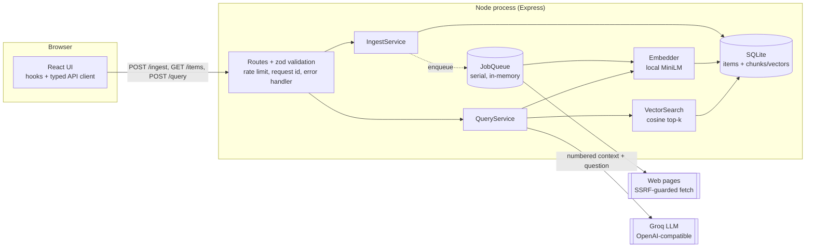
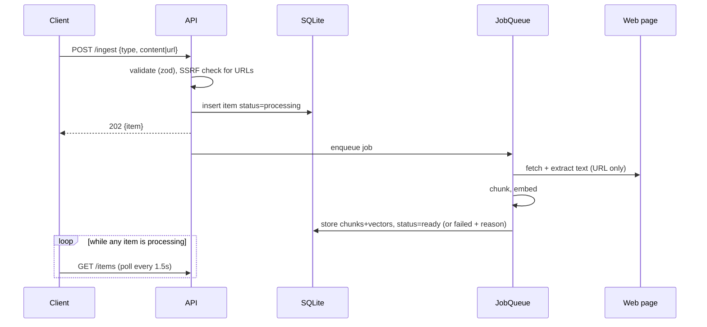
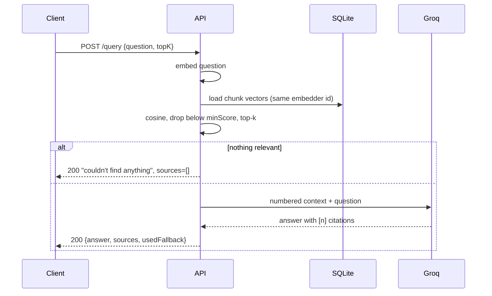

# System design

How the AI Knowledge Inbox is put together, how far it scales today (measured), and how it would grow.
Decisions are recorded as short ADRs in [`../adr`](../adr/README.md); the API contract is
[`../../contract/openapi.json`](../../contract/openapi.json).

## 1. Requirements that shaped the design

| Requirement | Consequence |
|---|---|
| Save notes and URLs; single user, no auth | One inbox, no tenancy. Rows have no `user_id` yet (see section 6). |
| Fetching and embedding are slow, asking must be fast | Async ingest: accept immediately, process in the background ([ADR 0002](../adr/0002-async-ingest-with-in-process-queue.md)). |
| Answers must be grounded and cited | Retrieve first, restrict the LLM to numbered passages, return the same passages as `sources`. |
| Runs locally with one command | SQLite file, in-process queue, local embeddings: no Docker, no Redis, no vector DB ([ADR 0001](../adr/0001-sqlite-brute-force-vector-search.md)). |
| Debuggable | Structured logs with a request id, consistent error codes, failed items store a reason. |

## 2. Component view



Layering rule (same idea as the SCMS backend): routes are thin and only validate and translate; services own the
rules; repositories own SQL; `container.ts` is the only place concrete classes are wired, so tests substitute
fakes for the embedder, LLM and fetcher.

## 3. Request flows

### Ingest (async)



### Query (sync)



## 4. Data model

```
items(id, type note|url, title, source_url, content, status processing|ready|failed, error, created_at)
chunks(id, item_id → items ON DELETE CASCADE, position, text, embedder, embedding BLOB float32[384])
```

`embedder` is stored per chunk so vectors from different models are never compared.

## 5. Capacity: can it handle 1000+ requests?

**Yes. 1000+ requests complete with zero errors, and after the two fixes below one instance sustains roughly 170 to
220 queries/s and over 1000 list requests/s at this data size.**

Measured with `scripts/load-test.mjs` against a single Node process on a Windows dev laptop (loopback, so treat as
relative numbers). Setup: real local MiniLM embeddings, no Groq (extractive answers, so LLM latency is *not* included),
`RATE_LIMIT_PER_MINUTE=0`, notes of about one chunk each (so items = chunks).

| Scenario (requests / concurrency) | Before | After |
|---|---|---|
| `GET /items`, 400 items (2000 / 100) | 420 rps, p50 227 ms | **1170 rps, p50 69 ms** |
| `GET /items`, 1400 items (2000 / 100) | 120 rps, p50 776 ms, 581 KB per response | **1448 rps, p50 63 ms**, 50 items per page |
| `POST /query`, 400 chunks (1000 / 50) | 134 rps, p50 361 ms | **181 rps, p50 272 ms** |
| `POST /query`, 1400 chunks (1000 / 50) | 77 rps, p50 618 ms | **215 rps, p50 223 ms** |
| `POST /query`, 1400 chunks (1000 / 200) | n/a | 176 rps, p50 1.06 s, p99 1.9 s |
| `POST /ingest` burst (1000 / 50) | 837 rps, all `202`, p50 45 ms | unchanged (not affected) |
| Indexing a 1000-note backlog | ~100 notes/s, drained in ~10 s | unchanged |

Every run: zero failed requests.

What the numbers say:

- **Ingest scales best because it is async.** 1000 notes were accepted in 1.2 s and drained in the background; queries
  stayed responsive during the backlog (p50 76 ms at concurrency 10).
- **Query no longer slows down as data grows.** Before, every query read and decoded all vectors from SQLite, so
  throughput fell from 134 to 77 rps going from 400 to 1400 chunks. Now vectors are cached in memory as one matrix and
  queries run at about the same speed at both sizes. The remaining cost is embedding the question on the main thread,
  and the scan is still O(n) (cheap at this size, the next wall at tens of thousands of chunks).
- **Under heavy concurrency, queries queue.** At 200 concurrent queries the p50 is about 1 s because one Node process
  embeds them one after another. This is the case for moving embedding to a worker thread or separate service.
- **Real `/query` is slower than measured**: it adds a Groq call (hundreds of ms) and is bound by Groq's own rate
  limits, which were not measured here.
- **Default rate limit is 60 requests/min per IP** on `/ingest` and `/query`, so one client cannot actually send 1000
  requests a minute. That is deliberate protection of the LLM quota; the load tests disable it.

### What changed to get there

1. **`GET /items` is paginated** (keyset, not offset): `?limit=50&cursor=...&status=...` returns
   `{ items, nextCursor, total }`. The index `(created_at DESC, id DESC)` makes each page a range scan. The UI shows
   "Load more" and polls only `?status=processing`, re-fetching just the items that finished, so poll cost no longer
   grows with the inbox.
2. **Vector cache**: `VectorSearch` keeps all vectors in one contiguous `Float32Array` and rebuilds it only when the
   database *revision* changes. The revision (table `meta`) is bumped by SQL triggers on any chunk insert/delete or
   item status change, including cascade deletes, so the cache cannot go stale no matter which code path wrote.

## 6. Scaling path

Steps 1 and 2 are done. The rest, in order; each removes the next bottleneck.

| Step | Change | Removes |
|---|---|---|
| 1 (done) | Paginate `GET /items`, poll only processing items | Large responses and poll cost |
| 2 (done) | In-memory vector matrix with trigger-based revision | Per-query SQLite read and decode |
| 3 | Run embedding in a worker thread (or a separate service) | Event-loop blocking; query queueing under concurrency |
| 4 | Several API instances behind a load balancer; move the queue to a durable broker (BullMQ/SQS) with separate indexing workers | Single-process ceiling, lost jobs on restart (each instance keeps its own cache; the DB revision keeps them correct) |
| 5 | Postgres + pgvector (HNSW) or Qdrant; per-user `user_id` filters; auth | O(n) scan, single writer, single tenant |
| 6 | Response cache for repeated questions, per-user quotas, hybrid BM25 + vector with reranking | LLM cost and retrieval quality |

Failure handling today: a failed fetch/embed marks the item `failed` with a message; a restart marks leftover
`processing` items `failed` (the queue is in memory); an LLM failure returns `502` with a readable message and never
a partial answer.

## 7. Security notes

- SSRF guard on URL ingest: resolve and reject private/loopback/link-local ranges, re-check every redirect hop,
  10 s timeout, 2 MB cap, content-type allowlist. Known gap: DNS-rebinding race between check and connect.
- Fetched page text is untrusted model input (prompt injection); the prompt constrains the model to the numbered
  passages, but this is mitigation, not a guarantee.
- Secrets only via environment (`.env` is git-ignored); input size limits on every body; per-IP rate limit.
